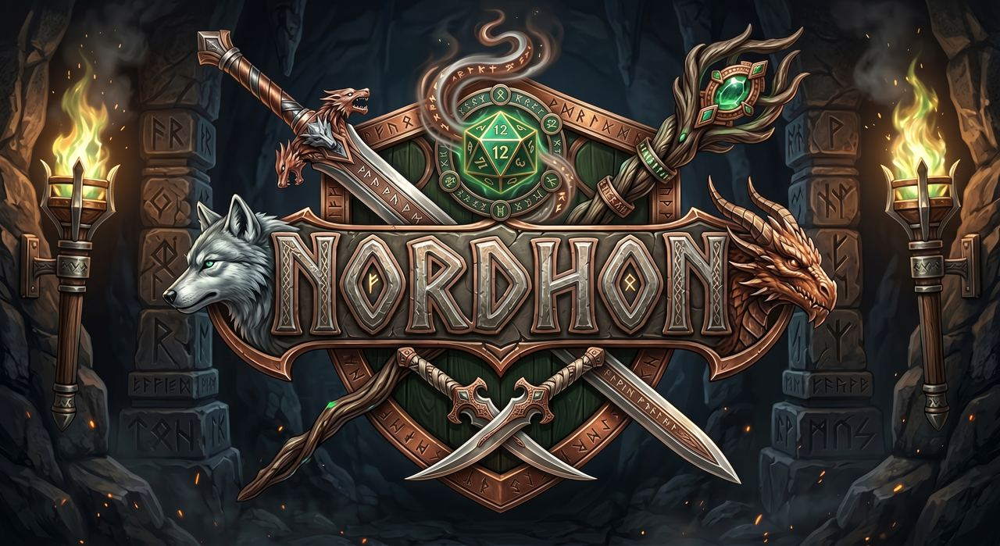
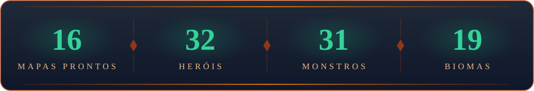
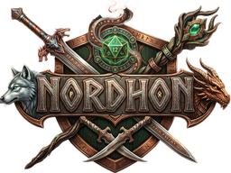

  

<h3 align="center"><i>“Aquele que permanece quando tudo muda.”</i></h3>

  
  
  

## ⚔️ O que é o Nordhon

**Nordhon** (*Nord*, o mundo que existe, + *Hon*, aquilo que resiste) é uma **mesa virtual 3D de RPG de fantasia**,
com sistema de regras próprio, feita para jogar no navegador, sem instalar nada.

O grupo entra na mesa, vê o mapa em 3D, rola os dados na tela de todo mundo e joga por turnos, com ou sem um Mestre
de carne e osso.

## 🎲 Três jeitos de jogar

<table>
  <tr>
    <td width="33%" valign="top">
      <h3>🧙 Com Mestre</h3>
      Uma pessoa conduz a história: monta as cenas, posiciona inimigos e armadilhas, abre passagens e revela o que o
      grupo descobre.
    </td>
    <td width="33%" valign="top">
      <h3>📜 Mestre Automático</h3>
      Roteiros prontos, eventos aleatórios e inimigos que jogam sozinhos. Dá para começar uma aventura sem ninguém
      precisar mestrar.
    </td>
    <td width="33%" valign="top">
      <h3>🔥 Survival</h3>
      Ondas de monstros cada vez mais fortes. O grupo resiste o quanto conseguir.
    </td>
  </tr>
</table>

  

## 🗺️ Na mesa

- **Turnos de verdade:** iniciativa, deslocamento por turno, uma ação por vez, ataques com alcance e crítico, magias em
  área e condições que agem no início do turno.
- **Mapas que viram campanha:** até 12 cenas por mapa, emboscadas, casas-gatilho e passagens entre cenas. O Mestre salva
  o mapa inteiro e reaproveita em outras campanhas.
- **Dados 3D:** o resultado vem do servidor e a animação aparece para o grupo inteiro, com skins para escolher.
- **Mesa social:** chat com moderação e vídeo entre os jogadores.
- **Área do Mestre:** campanhas, mapas, personagens e monstros próprios, além de imagens, áudio e modelos 3D.
- **Jogo justo:** todas as regras rodam no servidor. O cliente só pede ações e mostra o que o jogador pode ver.

## 🛠️ Forjado com

  
  
  
  
  
  
  
  
  

## 🛡️ A guilda

<table>
  <tr>
    <td align="center">
      <a href="https://github.com/jhonatasortega"> <b>@jhonatasortega</b></a>
    </td>
    <td align="center">
      <a href="https://github.com/marcosbathin"> <b>@marcosbathin</b></a>
    </td>
  </tr>
</table>

   
  <i>Enquanto houver alguém para lembrar, Nordhon permanece.</i> 
  O código do jogo é fechado. Esta página é a vitrine pública da organização.

